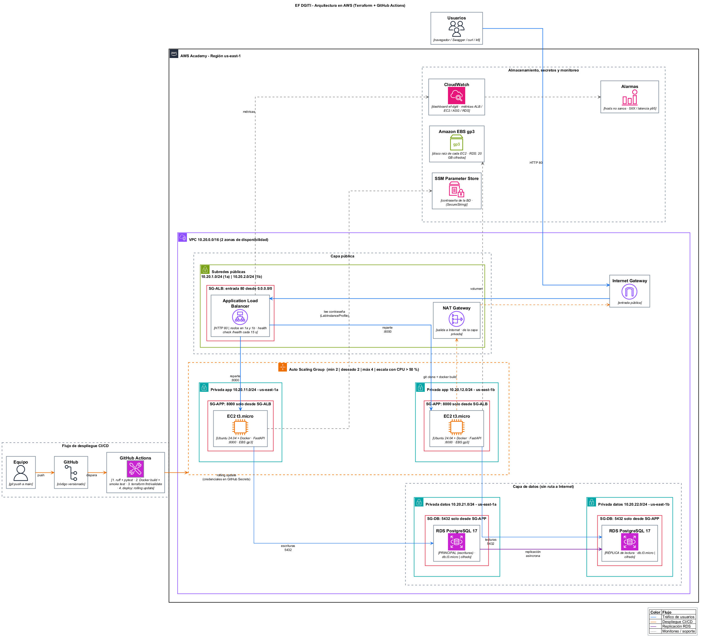

# EF DGITI — Despliegue, automatización y validación de infraestructura AWS

Evaluación final de *Diseño y Gestión de Infraestructura Tecnológica*.
Grupo: **Erick, Nicolay y Santiago**.

API REST (FastAPI) desplegada en AWS con Terraform, detrás de un Application Load
Balancer, con Auto Scaling en dos zonas, RDS PostgreSQL con réplica de lectura,
pipeline CI/CD en GitHub Actions, pruebas de carga con k6 y monitoreo en CloudWatch.



## Arquitectura

| Capa | Recursos | Decisión |
|---|---|---|
| Red | VPC `10.20.0.0/16`, 6 subredes en 2 AZ | Tres capas: pública (ALB, NAT), privada de aplicación (EC2), privada de datos (RDS, sin ruta a Internet) |
| Entrada | Application Load Balancer (HTTP 80) | Único punto expuesto a Internet; reparte tráfico y hace health check a `/health` cada 15 s |
| Cómputo | Launch Template + Auto Scaling Group (mín 2, máx 4, t3.micro, Ubuntu 24.04 + Docker) | Una instancia por zona como mínimo: si cae una, la otra atiende y el ASG la reemplaza. Escala por CPU al 50 % |
| Datos | RDS PostgreSQL 17 principal (AZ a) + réplica de lectura (AZ b) | Escrituras a la principal, lecturas a la réplica; cifrado en reposo; sin acceso público |
| Seguridad | SG encadenados: Internet → ALB:80 → EC2:8000 → RDS:5432 | Cada capa solo acepta tráfico del Security Group anterior. Contraseña de BD en SSM Parameter Store (SecureString), IMDSv2 obligatorio |
| Almacenamiento | EBS gp3 en cada EC2, 20 GB cifrados en cada RDS | Los datos viven en RDS (con respaldo automático y réplica); las EC2 son desechables y se reconstruyen desde el código |
| Monitoreo | Dashboard y 3 alarmas en CloudWatch | Solicitudes, latencia p95/p99, códigos HTTP, hosts sanos, CPU, instancias del ASG, RDS y retraso de la réplica |

## Endpoints

| Método | Ruta | Descripción |
|---|---|---|
| GET | `/health` | Health check del ALB |
| GET | `/status` | Instancia, zona, versión (commit) y estado de BD principal/réplica |
| GET | `/api/items` | Lista ítems (lee de la **réplica**) |
| POST | `/api/items` | Crea ítem (escribe en la **principal**) |
| GET | `/api/stress?n=20000` | Trabajo de CPU para pruebas de carga |
| GET | `/docs` | Swagger UI |

## Estructura

```
app/                  código de la API (FastAPI + SQLAlchemy)
tests/                pruebas unitarias y de integración (pytest)
infra/                Terraform: provider.tf, variables.tf, main.tf, outputs.tf,
                      terraform.tfvars.example, user_data.sh
.github/workflows/    pipeline CI/CD
load-tests/           k6-load.js (prueba de carga) y balance-check.ps1 (reparto del ALB)
scripts/              deploy.ps1, destroy.ps1, set-github-secrets.ps1
docs/                 diagrama de arquitectura y guion del video
salidas/              salidas reales de terraform init/plan/apply/output
```

## Despliegue

1. Iniciar el laboratorio en AWS Academy y copiar `AWS Details → AWS CLI` en `%USERPROFILE%\.aws\credentials`.
2. Ejecutar:

   ```powershell
   powershell -ExecutionPolicy Bypass -File scripts\deploy.ps1
   ```

   Equivale a `terraform init`, `plan`, `apply` y `output` dentro de `infra/`.
3. Probar:

   ```powershell
   curl.exe http://<alb_dns_name>/health
   powershell -ExecutionPolicy Bypass -File load-tests\balance-check.ps1 -Url http://<alb_dns_name>
   k6 run -e BASE_URL=http://<alb_dns_name> load-tests/k6-load.js
   ```

4. Al terminar: `scripts\destroy.ps1`.

## Resultados de desempeño (k6, 29/10/2026)

Misma prueba dos veces: 6 minutos, rampa hasta 150 usuarios virtuales, 70 % de tráfico a `/api/stress`.

| | 2 instancias | 4 instancias (tras el auto scaling) |
|---|---|---|
| Solicitudes totales | 27.773 | 44.360 |
| Solicitudes por segundo | 77 | **123** (+60 %) |
| Tiempo promedio | 638 ms | **212 ms** |
| p95 | 2.057 ms | **498 ms** (−76 %) |
| p99 | 2.639 ms | 776 ms |
| Errores | 0,05 % | **0 %** |
| Pico en el ALB (CloudWatch) | ~5.500 req/min, plano (saturado) | 11.242 req/min |
| CPU promedio del ASG (pico) | 91 % | 87 % |

Con 2 instancias la CPU de las t3.micro llega al 90 % y el throughput se estanca. La
alarma de *target tracking* (CPU > 50 % por 3 minutos) subió el ASG de 2 a 4 instancias;
con 4, el mismo tráfico se atiende con el doble de capacidad y un cuarto de la latencia p95.

## Pipeline CI/CD

`push` a `main` →

1. **Lint y pruebas**: `ruff` + `pytest` (11 pruebas unitarias e integración con SQLite) + reporte JUnit/cobertura como artefacto.
2. **Docker**: build de la imagen y smoke test del contenedor (`/health`, `/status`, `POST /api/items`).
3. **Terraform**: `fmt -check`, `init`, `validate`.
4. **Despliegue**: con las credenciales en *GitHub Secrets* (entorno `aws-academy`), inicia un *instance refresh* del ASG. Las EC2 nuevas clonan el último commit y el reemplazo es gradual (mínimo 50 % sanas), sin caída del servicio. Termina con una prueba de humo contra el ALB.

Las credenciales de AWS Academy caducan con cada sesión del laboratorio; se actualizan con `scripts\set-github-secrets.ps1`.
